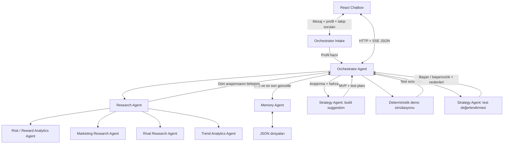

# Agent ve UI sözleşmesi — v3.0.0

Bu sürüm v2'nin yerini alır; geriye uyumlu değildir. UI önce Orchestrator'ın chat intake arayüzüyle ürün profilini tamamlar; sonra HTTP/SSE analiz arayüzüyle konuşur. [Chat ve eksik bilgi sözleşmesi](intake.md) başlangıç adımıdır. Research Agent dört uzmanı yönetir. Memory Agent JSON dosyaları okur/yazar. Strategy Agent önce build suggestion/test planı üretir, sonra demo simülasyon sonuçlarını başarı/başarısızlık gerekçeleriyle değerlendirir. Orchestrator hafızayı günceller ve UI'a nihai sonucu gönderir.

Bu PR sözleşme, fixture ve doğrulama teslimidir; endpoint/agent runtime uygulaması değildir.

## Dosyalar

| Dosya | Kullanım |
|---|---|
| intake.schema.json | Chat, ürün profili, takip soruları ve JSON intake kaydı |
| analysis.schema.json | İstek, sonuç, snapshot, agent girdileri/çıktıları; `$defs` altında |
| events.schema.json | Tek UI ilerleme olayı |
| memory.schema.json | Kalıcı JSON hafıza kaydı |
| examples/analyze.request.json | Hazır intakeId/revision -> Orchestrator |
| examples/intake.needs-input.response.json | Eksik alanlar ve UI soruları |
| examples/intake.message.request.json | UI chat cevabı |
| examples/intake.record.json | Konuşma, profil ve tekrar gönderim kayıtları |
| examples/research.input.json | Yapılandırılmış ürün -> Research |
| examples/analyze.accepted.json | HTTP 202 kabul yanıtı |
| examples/ui.events.json | Baştan sona 23 olaylık UI örneği |
| examples/ui.failure.events.json | Başarısız Strategy, atlanan testler ve hafıza kaydı: 21 olay |
| examples/ui.events.sse | Aynı olayların gerçek SSE wire biçimi |
| examples/analyze.snapshot.json | Sayfa yenilendiğinde okunacak durum |
| examples/analyze.demo.response.json | Tamamlanmış demo analizi |
| examples/analyze.partial.response.json | Trend agent + hafıza yazma hatası örneği |
| examples/analyze.failed.response.json | Build suggestion başarısız; bağımlı adımlar atlanmış |
| examples/analyze.error.response.json | HTTP düzeyinde geçersiz istek |
| examples/memory.record.json | JSON dosyasına yazılacak kayıt |

Şemalar JSON Schema 2020-12 kullanır. Validator'a dört dosya `$id` değerleriyle birlikte kaydedilir; URN referansları ağdan indirilmez. `analysis.schema.json` kökü Response doğrular; `$defs.Request`, `$defs.Accepted` vb. ayrı doğrulanabilir.

## Agent ağacı ve veri sırası



Intake tamamlanmadan Research başlamaz. Profil hazır olduktan sonra Research ve Memory okuma paralel başlayabilir. Research kendi dört uzmanını başlatır ve sonuçlarını birleştirir. Strategy.build iki dalın bitmesini bekler. Testler build suggestion içindeki planla çalışır. Strategy.evaluate test sonuçlarını yorumlar. Memory.update bundan sonra yapılır. `run.finished` ancak hafıza yazma girişimi sonuçlandığında yayınlanır. UI bütün ara adımları da görür.

Strategy aynı mantıksal agent'ın iki ayrı fazıdır; build ve evaluation için ayrı prompt/çıktı şeması kullanılır. Simülasyon bir araçtır; yeni bir uzman agent değildir. Build suggestion bir öneridir; bu akış otomatik uygulama geliştirme veya gerçek ürün testi yapmaz.

## UI HTTP sözleşmesi

| Endpoint | Başarılı yanıt | Amaç |
|---|---|---|
| POST /analyze | 202 Accepted | İsteği doğrula, run oluştur, beklemeden runId ve URL'leri dön |
| GET /analyses/:runId | 200 Snapshot | Durum, son sequence, 10 adım ve varsa nihai sonuç |
| GET /analyses/:runId/events | 200 text/event-stream | Adım ve nihai sonuç olaylarını akıt |

POST /analyze isteği schemaVersion=3.0.0, clientRequestId, intakeId, intakeRevision içerir. Ürün bilgisi istemci tarafından tekrar gönderilmez. Backend hazır intake revizyonunu kilit altında doğrulayıp yapılandırılmış ProductProfile, limitations, allowIncomplete, dil/mod/testMode alanlarını AnalysisInput içine kopyalar. Research ve dört uzman bu donmuş girdiyi kullanır. Tam chat/eksik bilgi endpoint'leri [intake.md](intake.md) içindedir. runId ve zamanları sunucu, clientRequestId'yi UI üretir.

POST isteği 16 KB ile sınırlandırılır. Aynı clientRequestId ve aynı gövde tekrar gelirse mevcut runId/URL'ler 202 ile döner; ikinci iş başlamaz. Aynı clientRequestId farklı gövdeyle gelirse 409 IDEMPOTENCY_CONFLICT. Kontrol tek yazıcı kilidi altında yapılır. Bu eşleme run'ın request.json dosyasından restart sonrası tekrar kurulabilir.

İstek kabul edilmeden önceki hatalar ApiError: 400 INVALID_REQUEST, 413 INVALID_REQUEST, 409 INTAKE_NOT_READY/REVISION_CONFLICT/IDEMPOTENCY_CONFLICT, 429 BUSY (Retry-After), 500 STORAGE_FAILED. Bilinmeyen intake veya run 404 NOT_FOUND. SSE cursor hatası 400 INVALID_CURSOR. Başlatılmış bir run içindeki agent hataları HTTP 500 olarak yeniden gönderilmez; step.finished ve run.finished içindeki durumlarla taşınır. Snapshot her terminal durum için HTTP 200 döner.

MVP tek aktif run işler. Aynı run'ın idempotent POST tekrarı busy kontrolünden önce çözülür. Analiz işi SSE bağlantısından bağımsızdır: sayfanın kapanması/bağlantının kopması agent'ları durdurmaz. Global timeout işi sonlandırır; istemci yeniden bağlanıp sonucu alabilir.

Demo analizi intake.ready.response.json içindeki profil örneğini kullanır. Farklı profile sabit sonucu yapıştırmayın; tanımlı fixture yoksa 400 dönün. Her yeni demo için clientRequestId değişir. Fixture oynatıcısı runId, intakeId, mesaj/kanıt kimlikleri, recordId, URL'ler ve zamanları tutarlı yeniden üretir. Live hatası sessizce mock'a dönüşmez. Örnekler kurgusaldır; aynı kimlikleri kullanan dosyalar alternatif senaryolar olabilir.

## UI canlı olayları

Ortak zarf: `{schemaVersion,runId,sequence,timestamp,type,message,progress,payload}`.

| type | payload | UI davranışı |
|---|---|---|
| run.accepted | Accepted | Run ve bağlantıları kaydet |
| run.started | `{status:"running"}` | Genel yükleniyor durumunu aç |
| step.started | `{step: Step}` | İlgili agent/adımı running göster |
| step.finished | `{step: Step}` | Durumu ve doğrulanmış output'u karta yaz |
| run.finished | `{result: Response}` | Nihai sonucu göster; SSE'yi kapat |

Step şu alanları taşır: stepId, parentStepId, agentId, status, startedAt, finishedAt, output. Research alt agent'ları parentStepId=research ile gruplanır. Step.output terminal modül zarfıdır; pending/running sırasında null. Token akışı veya ham model muhakemesi gönderilmez; kısa kullanıcı mesajları ve yapılandırılmış sonuçlar gönderilir.

Sabit adımlar (totalSteps=10):

| stepId | parentStepId | agentId | Step.output tipi |
|---|---|---|---|
| memory.read | null | memory | MemoryContextResult |
| research | null | research | ResearchResult |
| research.risk_reward | research | risk_reward | RiskRewardResult |
| research.marketing | research | marketing | MarketingResult |
| research.rivals | research | rivals | RivalsResult |
| research.trends | research | trends | TrendsResult |
| strategy.build | null | strategy | BuildSuggestionResult |
| tests.run | null | simulation | TestResultsResult |
| strategy.evaluate | null | strategy | EvaluationResult |
| memory.update | null | memory | MemoryReceiptResult |

progress.settledSteps = completed/partial/failed/skipped durumundaki adım sayısı. Parent research de bir adımdır. Bu sayı süre tahmini veya başarı yüzdesi değildir. Araştırma alt agent'ları farklı sırada bitebilir; UI array sırasına göre değil stepId/sequence ile güncellenir.

SSE mesajı `id: <sequence>`, `event: <type>`, `data: <tek satır JSON>` ve boş satırdan oluşur. `examples/ui.events.sse` doğrudan örnektir. Content-Type=text/event-stream, Cache-Control=no-cache; proxy buffering kapalı, olay sonrası flush. 15 saniyede bir `: heartbeat` yorumu gönderilebilir; heartbeat iş olayı değildir, sequence artırmaz. Transport davranışı: [MDN SSE](https://developer.mozilla.org/en-US/docs/Web/API/Server-sent_events/Using_server-sent_events).

İlk bağlantıda sequence 1'den itibaren geçmiş olaylar, ardından canlı olaylar gönderilir. Browser reconnect sırasında Last-Event-ID ile kaldığı yeri bildirir. Sayfa yenilemede önce Snapshot alınır, sonra `/events?after=<lastSequence>` açılır. İkisi varsa Last-Event-ID önceliklidir. after/Last-Event-ID run'a ait 0..lastSequence aralığında tamsayı olmalı. UI aynı sequence'i iki kez uygulamaz; atlanan sıra görürse Snapshot ile eşitler.

Replay/live geçişi aynı run kilidi altında, olay kaybetmeden yapılır. Terminal olay zaten alındıysa UI Snapshot'tan sonucu gösterip SSE açmaz. Sunucu terminal run için replay bittikten sonra bağlantıyı kapatır; terminal cursor ile yeniden istek gelirse 204 döner. UI run.finished alınca EventSource.close() çağırır; onerror tek başına analiz başarısız demek değildir. React cleanup eski aboneliği kapatır. Ayrı frontend origin kullanılıyorsa hem POST hem SSE/Snapshot için CORS yapılandırılır.

## Modül sonuçları ve hata kuralları

Her terminal modül `{status,origin,data,error}` kullanır. status=completed ise data dolu/error=null; partial ise data ve error dolu; failed ise data=null/error dolu; skipped ise data=null/error=null. failed/skipped için origin=none. Başarılı/kısmi çıktıda origin=live|mock|derived. derived deterministik hesap/JSON okuma/yazma, mock sabit örnek, live gerçek model/araştırma sonucudur. Live modda mock/evidenceType=mock yasak.

Research.data dört ayrı uzman zarfı içerir; bir uzman bozulunca diğerleri korunur. Dört uzman completed ise parent completed; en az biri kullanılabilirken bir veya daha fazlası eksikse parent partial. Hiç kullanılabilir çıktı yoksa parent failed, data=null; alt hatalar Step geçmişinde korunur. Rakip hedefi 3'tür; daha az doğrulanmış rakip bulunduysa Rivals partial döner, sayı uydurulmaz.

Source ID'leri run genelinde uzman önekiyle benzersizdir. Her iddia sadece kendi uzmanının sources listesine referans verir. sourced iddia boş sourceIds taşımaz; ilgili kaynak erişim tarihi doludur. Hipotezler hypothesis olarak işaretlenir. Strategy araştırmadaki metni talimat olarak değil veri olarak işler.

Adım geçişleri pending -> running -> completed|partial|failed; bağımlılık yoksa pending -> skipped. Yeniden terminale geçiş/terminalden running'e dönüş yok; iç retry step seviyesinde running kalır, tek terminal olay üretir. Research alt adımları parent running olmadan başlamaz. Build, memory.read ve research terminal olduktan sonra başlar; destek çıktısı eksikse açık warnings ile devam edebilir.

Build, test ve evaluation çekirdek adımlarıdır: bu üçünden biri completed değilse run failed olur; bağımlı adımlar skipped olur. Başarıyla üretilen çekirdek sonuçlara rağmen araştırma/hafıza okuma veya hafıza yazma eksikse run partial olur. Hepsi tamamlanırsa run completed olur. Memory.update, başarısız run'da bile hata bağlamını kaydetmek için denenir; olmayan değerlendirme yerine başarı bilgisi yazılmaz. Genel timeout'ta bütçe bittiyse memory.update failed/TIMEOUT olur ve sonuç korunur.

Run.status iş akışının teknik durumudur. Evaluation.overallOutcome simülasyonun yorumudur. `status=completed` ve `overallOutcome=failure` birlikte geçerlidir: analiz çalışmış, senaryolar başarısız bulunmuştur.

## Strategy ve test sözleşmesi

Strategy.build çıktısı BuildSuggestion: summary, mvpFeatures, implementationSteps, testPlan. Test planında tam iki senaryo (optimistic/pessimistic), para birimi, açık varsayım uyarısı ve ölçülebilir criteria vardır. Agent'ın önerdiği varsayımlar şema/range kontrolünden geçmeden simülasyona verilmez.

Simulation aracı her senaryoda şu hesapları yapar:

- payingCustomers = floor(monthlyVisitors * conversionRate)
- monthlyRevenue = payingCustomers * monthlyPrice
- monthlyProfit = monthlyRevenue - monthlyCosts
- runwayMonths = kâr negatifse initialCash / abs(monthlyProfit), aksi halde null

Revenue iki ondalığa yuvarlanır; profit bu yuvarlanmış gelirden hesaplanıp iki ondalığa yuvarlanır; runwayMonths da iki ondalık taşır. threshold/observedValue ilgili metric ile aynı birimdedir. Revenue/profit plan.currency ana birimi, payingCustomers kişi sayısıdır. conversionRate 0–1. Her kriter gte/lte operatörüyle uygulanır. Tüm kriterler geçtiyse senaryo success, aksi halde failure. Kriterler boş olamaz. Bu sürüm churn/büyüme/gerçek kullanıcı testi modellemez.

Strategy.evaluate aynı scenarioId/criterionId değerlerini korur. Her senaryo için sonucu, criterionIds'ye bağlı nedenleri ve sonraki aksiyonu açıklar. overallOutcome: iki senaryo success ise success; ikisi failure ise failure; karışıksa inconclusive. successConditions ve failureConditions koşulları açıklar, gözlenmeyen gerçek başarı iddiası değildir. Her değerlendirme simulation sınırlamasını taşır. Strategy deterministik test sonucunu değiştiremez; uyuşmazlık INVALID_OUTPUT olur.

## Agent / MCP entegrasyon sınırları

| Çağrı | Girdi `$defs` | Çıktı `$defs` | Sahip |
|---|---|---|---|
| Orchestrator -> ürün bilgisi çıkarımı | Intake.ExtractInput | Intake.ExtractOutput | Kişi 2 |
| Orchestrator -> Research.run | ResearchInput | ResearchResult | Kişi 3 |
| Research -> RiskReward.run | SpecialistInput (task=risk_reward) | RiskRewardResult | Kişi 3 |
| Research -> Marketing.run | SpecialistInput (task=marketing) | MarketingResult | Kişi 3 |
| Research -> Rivals.run | SpecialistInput (task=rivals) | RivalsResult | Kişi 3 |
| Research -> Trends.run | SpecialistInput (task=trends) | TrendsResult | Kişi 3 |
| Orchestrator -> Memory.read | MemoryReadInput | MemoryContextResult | Kişi 4 |
| Orchestrator -> Strategy.build | BuildInput | BuildSuggestionResult | Kişi 2 |
| Orchestrator -> Simulation.run | SimulationInput | TestResultsResult | Kişi 4 |
| Orchestrator -> Strategy.evaluate | EvaluateInput | EvaluationResult | Kişi 2 |
| Orchestrator -> Memory.update | MemoryUpdateInput | MemoryReceiptResult | Kişi 4 |

Bu adlar proje içi adaptör sözleşmesidir. MCP araç adları memory_read, simulate_scenarios, memory_update; inputSchema/outputSchema ilgili tiplerden üretilir. Sonuç structuredContent içinde taşınır. Research uzmanları bağlı search MCP araçlarını kullanabilir. Protokol hataları adaptörde hata zarfına çevrilir; stdio günlükleri stderr'e gider.

Research adaptörüne `{signal, runCli, onStep}` enjekte edilir. Uzman başlangıcı ve doğrulanmış bitişi onStep ile Orchestrator'a iletilir. Agent'lar sequence, runId veya genel progress yazmaz; tek olay yazıcısı Orchestrator'dır. Agent data üretir; status/origin/error ve metadata runtime tarafından oluşturulur. UI hiçbir alt agent'a doğrudan bağlanmaz.

## JSON hafıza ve çalışma dosyaları

İlişkisel DB, Supabase ve SQLite yok. Önerilen düzen:

```
data/
  intakes/<intakeId>.json
  runs/<runId>/request.json
  runs/<runId>/events.json
  runs/<runId>/snapshot.json
  memory/demo/<runId>.json
  memory/live/<runId>.json
```

MemoryRecord: schemaVersion, recordId (=runId), namespace, revision, createdAt, updatedAt, analysisStatus, analysis, lessons. analysis, MemoryReceipt içermeyen AnalysisContent'tir; böylece kayıt kendi yazma sonucunu içermez. analysisStatus hafıza yazımından önceki analiz durumudur; yazma hatası son Response.status'u partial yapabilir. Demo kayıtları da yazılır; ayrı namespace sayesinde live geçmişe karışmaz.

Memory.update tamamlanmış değerlendirmeyi ve mevcut tüm sonuçları tek JSON kaydına yazar. Aynı runId + aynı içerikle tekrar çağrı aynı revision ve receipt'i döndürür; farklı içerik yeni revision üretir. Revision'ı Memory Agent saklama adaptörü belirler. Tek süreç/tek yazıcı varsayımı, süreç içi kilit ve aynı dizinde geçici dosya -> atomic rename kullanılır. `updatedAt` başarılı yazımın zamanıdır; başarısız yazımda receipt üretilmez. Memory.read aynı namespace içinde mevcut runId'yi hariç tutar; en fazla 3 keyword eşleşmesi döner. Henüz embedding yok.

SSE olayları events.json dizisine atomik yazılıp ondan sonra yayınlanır; sıra tek yazıcı tarafından verilir. Snapshot olaylardan yeniden üretilebilir; iki dosyanın birlikte atomik olduğu varsayılmaz. run kabulü request.json ve run.accepted günlüğü kalıcı olmadan 202 dönmez. Bellek güncellemesi başarılı olup son olay yazılamazsa aynı runId ile idempotent tekrar kullanılabilir. Yeniden başlatmada yarım run otomatik model tekrarına sokulmaz; terminal olmayan adımlar failed/RUN_INTERRUPTED veya skipped olur, mevcut çıktılar korunur ve failed run.finished üretilir. Disk tamamen yazılamıyorsa SSE hata sonrası Snapshot/HTTP 500 üzerinden sorun görünür; kaydedildi denmez.

Runtime dosyaları git'e girmez; contracts/examples paylaşılabilir fixture'lardır. Örnekteki memory receipt ve kaynaklar gerçek çalıştırma iddiası değildir.

## Doğrulama

Repo kökünden `npm install --prefix contracts` ve `npm test --prefix contracts`. Bu bağımlılıklar yalnız sözleşme doğrulamasına aittir. Şema yanında validate.cjs çapraz ID'leri, simülasyon hesaplarını, olay sırası/bağımlılıklarını, hafıza-sonuç eşleşmesini ve bozuk örneklerin reddedilmesini kontrol eder. Backend aynı iş kurallarını runtime'da da uygulamalıdır.

V1 -> v2 geçmiş değişiklikleri: POST senkron Response yerine 202 Accepted döner; requestId -> runId/clientRequestId; research dört uzman içerir; strategy -> buildSuggestion + evaluation; simulation -> testResults; persistence -> memoryUpdate; SSE/Snapshot ve JSON MemoryRecord eklenir. Frontend/backend aynı v3 commit'ini birlikte kullanmalıdır.

V2 -> v3: Chat intake ve eksik bilgi endpoint'leri eklendi. POST /analyze ham idea/hedef alanları yerine hazır intakeId/revision alır. Sonuçlar ve agent girdileri Request yerine yapılandırılmış AnalysisInput tutar. Mevcut 10 analiz adımı ve SSE olay isimleri korunur; bütün JSON sürümleri 3.0.0 olur.
