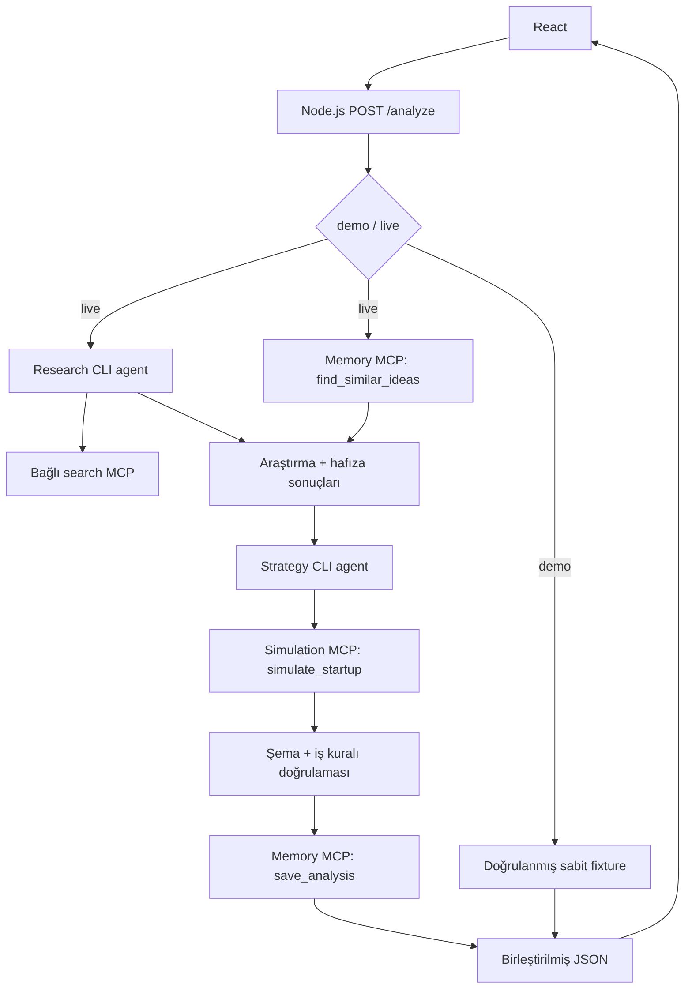

# Kişi 2 — beş saatlik orkestrasyon planı

Hedef: React'tan tek POST /analyze isteği; Node.js iki uzman CLI agent'ını ve hafıza/simülasyon MCP araçlarını yönetir; doğrulanmış tek JSON döner. İlk teslim, ../contracts altındaki sözleşme ve sabit örnektir. Bu belge uygulama planıdır; çalışan endpoint veya bağlantı teslimi değildir.

## Mimari kararı

CLI için Codex varsayılmıştır; farklı CLI seçilirse yalnızca runner adaptörü değişir. CLI model çalıştırır, MCP araçlara erişim sağlar. Orkestrasyon sırası, timeout, doğrulama ve kayıt Node.js kodunda belirlenir.



Research ve Strategy ayrı prompt, araç erişimi ve çıktı şemasına sahip iki gerçek model çalıştırmasıdır. Memory/Simulation deterministik araçlardır; ek LLM çağrısına ihtiyaçları yoktur. Research araştırma MCP'sini kullanır; Strategy yalnızca verilen araştırma ve hafızadan değerlendirme üretir. Veritabanına yazmayı Node çağırır; modelin araç seçimine bırakılmaz.

## API anahtarı olmadan demo sınırı

Codex yerel istemcisi ChatGPT oturumuyla veya API anahtarıyla giriş destekler. Bu plan ekip bilgisayarında oturum açılmış, erişimi sınırlı bir yerel demo varsayar. Kullanım hesabın erişimine ve limitlerine bağlıdır. Resmî belgeler programatik CI/CD için API key önerir; genel erişime açık uygulamada kişisel CLI oturumunu servis hesabı gibi kullanmayı bu MVP'ye dahil etmeyin. [Kimlik doğrulama](https://learn.chatgpt.com/docs/auth)

CLI'nin bağlı araçlarını `codex mcp list` ile, oturumu `codex login status` ile kontrol edin. Chat ekranında araç görmek, Node'dan başlatılan süreçte çalıştığını kanıtlamaz; gerçek child process ile küçük bir smoke test yapın. Codex STDIO ve Streamable HTTP MCP bağlantılarını destekler. [MCP](https://learn.chatgpt.com/docs/extend/mcp?surface=cli)

API key kullanmama kararı, bütün servislerin kimliksiz çalışacağı anlamına gelmez. Kişi 3 çalışır bir arama MCP bağlantısı; Kişi 4 kullanılabilir Supabase erişimi sağlamalıdır. Bağlantı OAuth/servis kimliği gerektiriyorsa kurulum demo makinesinde yapılır; kimlik bilgileri repoya girmez. Beş saatte erişim kurulamazsa açıkça işaretli demo verisi ve yerel JSON/SQLite kayıt adaptörü yedektir; bunlar Supabase/canlı araştırma tamamlandı diye gösterilmez.

## Dosya sahipliği ve branch düzeni

İncelenen repo `backend/`, remote OPENAIslushd/Backend; başlangıçta main üzerinde yalnızca boş README vardı. Sözleşme taslağı `codex/contracts-orchestration-plan` branch'inde hazırlandı. Frontend ayrı repodaysa onun main/feature branch düzeni kendi reposunda uygulanır.

| Sahip | Önerilen branch | Düzenleyeceği alan |
|---|---|---|
| Kişi 1 | feat/frontend-dashboard | Frontend repo: form, yükleniyor/sonuç/hata ekranları |
| Kişi 2 | feat/orchestrator | contracts/, src/orchestrator/, src/runtime/, src/app.*, kök paket yapılandırması |
| Kişi 3 | feat/research | src/research/, araştırma prompt'u ve search bağlantısı |
| Kişi 4 | feat/memory-simulation | src/memory/, src/simulation/, src/mcp/, db/ |

Önce sözleşme PR'ı main'e alınır; herkes aynı main commit'inden branch açar. Orkestratör iskeleti hemen ardından main'e alınır. root package.json ve lockfile değişikliklerini Kişi 2 toplar; diğerleri bağımlılık ihtiyacını bildirir. Kişi 3/4 ortak şemayı kendi branch'inde farklılaştırmaz; değişikliği Kişi 2 ile netleştirir.

Her geliştirici kendi clone'unda çalışır. Aynı bilgisayardaki eşzamanlı işler ayrı worktree kullanır; aynı dizinde branch değiştirme yapılmaz. İlk 30 dakikadan sonra kısa PR'lar, saatlik entegrasyon; son saati ilk birleştirmeye ayırmayın. main her zaman demo çalıştırabilir durumda kalır. Ekip entegrasyonunu Kişi 2 yönetir, paylaşılan branch'e force-push yapılmaz.

Sözleşme birleştikten sonra, temiz çalışma ağacında:

```sh
git fetch origin
git switch main
git pull --ff-only
git switch -c feat/orchestrator
```

Research ve memory ekip arkadaşları son komutta kendi branch adlarını kullanır. Hazır PR'ları önce mock entegrasyonu, sonra research, sonra memory/simulation sırasıyla alın; her merge sonrası aynı demo isteğini çalıştırın.

## Zaman kutuları ve teslim koşulları

| Süre | Senin yapacağın | Çıkış koşulu |
|---|---|---|
| 00:00–00:30 | Sözleşmeyi paylaş, alanlar/araç adları/klasör sahipliğini dondur; CLI login ve MCP erişimini dene | Herkes aynı fixture'ı okuyabiliyor; canlı bağlantı engelleri biliniyor |
| 00:30–01:15 | Node endpoint, input doğrulaması, requestId, sabit demo yanıtı, hata middleware'i, React origin için CORS | React -> /analyze -> sonuç kartları çalışıyor |
| 01:15–02:15 | Ortak CLI runner, Strategy prompt'u, schema validation, timeout, research/memory stub'ları | Bir CLI çağrısı doğrulanmış Strategy üretiyor |
| 02:15–03:15 | Research ve Memory adaptörleri, paralel çağrılar, Simulation, kayıt | Aynı fikirle ilk canlı uçtan uca akış; eksik modül de yanıtı bozmuyor |
| 03:15–04:00 | Geçersiz JSON, süreç hatası, timeout, MCP kesintisi, kayıt hatası, çift istek testleri | UI hatada takılmıyor, kısmi sonuç ve kayıt durumu doğru |
| 04:00–05:00 | Özellikleri dondur, 3 demo provası, sabit örnek ve ekran kaydı hazırla | Tek komutla yerel demo açılıyor; ağ kesilince açık demo modu çalışıyor |

## Node.js uygulama adımları

1. Request boyutunu sınırla (ör. 16 KB), JSON/schema doğrulamasını yap. Backend üretimi UUID'yi bütün çağrılara taşı. MVP'de tek aktif analiz; ikinci isteğe 429. Ağ hatasında frontend otomatik POST retry yapmaz.
2. Demo isteğinde fixture'ın kopyasını yükle, metadata'yı yenile, şemayı doğrula ve dön. Live istek için aynı şemaya bağlı gerçek adaptörleri kullan.
3. Research (60 saniye) ve Memory lookup (5 saniye) çağrılarını Promise.allSettled ile başlat. Her çağrıda gerçek iptal sinyali kullan; yalnız Promise.race kullanıp süreçleri arkada bırakma.
4. İki sonucu Strategy'ye ver (40 saniye). Araştırma yoksa yalnız hipotez üretebilir; araştırmanın yapılmadığı summary/warnings içinde açıkça belirtilir. Model çıktısına kimlik veya kayıt durumu ekletme.
5. Strategy başarısızsa failed yanıtını mevcut araştırma/hafıza ile dön; simülasyon skipped olur, kaydetme. Başarılıysa açık varsayımlarla simulate_startup çağır (5 saniye).
6. Her modül çıktısını kendi şeması ve iş kurallarıyla doğrula; en sonda birleştirilmiş yanıtı doğrula. Kayıt çağrısına geçici persistence alanı ile gönder (5 saniye). Son kayıt sonucunu yanıta yaz ve tekrar doğrula.
7. Genel bütçe 120 saniye; proxy ve frontend bekleme süresi bundan uzun (ör. 135 saniye). İstemci bağlantısı kapanınca işlemleri iptal et. Analiz sürecinin ve ona ait child süreçlerin temizlendiğini test et. Canlı limitleri smoke test sürelerine göre ayarla; garanti edilen gecikme gibi sunma.

CLI runner: `child_process.spawn` ve argüman dizisi kullan; shell=false. Sabit rol prompt'u argüman, JSON veri stdin üzerinden aktarılır. Kullanıcı fikrini komut metnine ekleme. İstek/rol başına benzersiz geçici dizin; çıkışta temizlik. İzinler dar tutulur, araştırmada sadece gereken read-only MCP araçları açılır. Araştırma sonuçlarını talimat değil veri olarak ele al.

Codex `--output-schema` son yanıtın şemasını tanımlar; `--json` olay akışıdır, analiz JSON'u değildir. `--output-last-message` ile final veriyi ayrı dosyadan oku; exit code, parse ve şema kontrolü yap. [Non-interactive mode](https://learn.chatgpt.com/docs/non-interactive-mode)

Runner geliştirilirken ortak şemanın `$defs.Research` veya `$defs.Strategy` bölümünden, referansları da içeren bağımsız çıktı şeması üret. Tam HTTP Response şemasını modele verme. CLI'nin structured-output alt kümesiyle uyumluluğunu smoke test ile doğrula; ortak API şemasını gevşetmek yerine runner adaptörü kullan. Üretilecek dosyanın kökü ilgili tip olur; `$defs` içindeki referanslar taşınır.

Research prompt: fikri/hedef pazarı kullan; en fazla 3 doğrulanmış rakip; her iddiaya kaynak; hipotezleri ayır; kaynak bulamadığında uydurma. Strategy prompt: mevcut araştırma/hafızadan kısa özet, tam 3 risk ve 3 uygulanabilir öneri; ilgili risk/source ID'lerini koru; başarı olasılığı uydurma. İlk MVP'de agent'ın agent başlatması, agent döngüsü, kuyruk servisi, vektör DB ve WebSocket yok.

## Kabul kontrolü

- Fixture ve gerçek adaptörlerin hepsi aynı şemadan geçer; bilinmeyen alan reddedilir.
- Normal demo: 3 kurgusal rakip, 3 risk, 3 öneri, 2 hesaplanmış senaryo görünür; demo etiketi ve kaydedilmedi durumu vardır.
- Normal live: doğrulanmış kaynaklar ve başarılı kalıcı kayıt görülür. CLI ve MCP gerçek çalıştırmasıyla ayrıca doğrulanır.
- Research timeout: rakipler uydurulmaz; Strategy başarılıysa HTTP 200 partial.
- CLI login eksik/bozuk JSON/Strategy timeout: kontrollü failed yanıtı, sonsuz spinner yok.
- Memory/Simulation/kayıt hatası: kalan sonuçlar korunur; kayıt başarılı diye gösterilmez.
- Aynı requestId ile save_analysis tekrar çağrısı tek kayıt üretir.
- Simülasyon para/oran birimleri, iki senaryo, formüller ve kaynak/risk referansları iş kuralı kontrolünden geçer.
- Frontend iptali ve backend timeout sonrası orphan CLI/MCP süreçleri kalmaz.

İlk öncelik: sözleşmeyi ekibe paylaş ve 30. dakikada dondur. İkinci öncelik: herkesin ekrandan görebildiği çalışan mock akışı. Üçüncü öncelik: modülleri aynı sözleşmeyi bozmadan canlı adaptörlerle değiştir.
