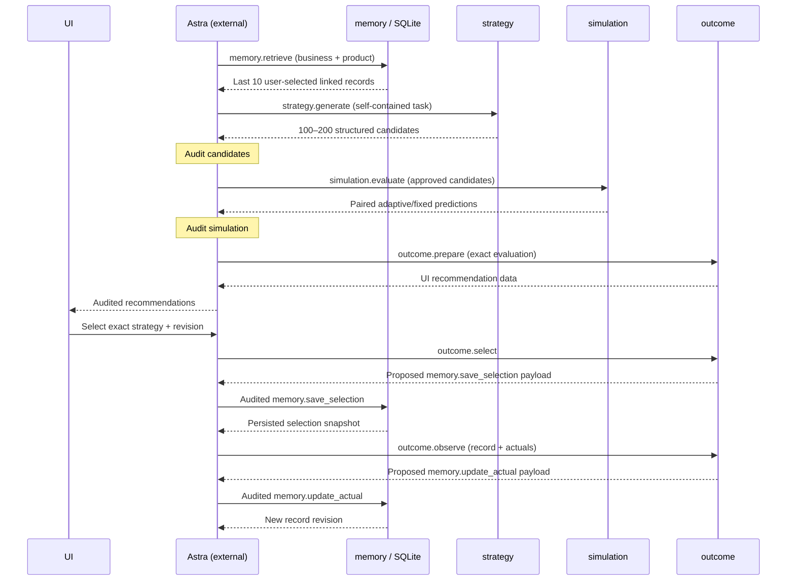

# Advertising strategy simulation agents

Four Node.js services generate advertising options, compare them in a numerical simulator, prepare three UI recommendations, and retain user selections with later observed results in SQLite. Astra is an external orchestrator. Each service answers Astra and never invokes another service.

**Implementation status:** code, contracts, examples, tests and CI configuration are written. No dependencies, application code, tests, builds or containers have been run locally. Runtime correctness remains unverified until the GitHub Actions checks run.

## Architecture and ownership



Astra supplies the business/product scope, keeps evaluations for later selection, removes held-out actuals from generation/simulation tasks, and owns all audits, retries, corrections and UI routing. Strategy does not query memory or accept raw history. Free-text `context` is Astra-curated context, not a place for raw observed outcomes. Automatic semantic detection of leaked information in text is not implemented.

Memory owns the only database. Outcome prepares proposed writes and returns them to Astra. A simulation winner and a user selection are never recorded as evidence of actual campaign success. A selected record contains the exact input, strategy/revision, evaluation identity, model version, seed, scenario count, assumptions, adaptive prediction, fixed prediction, and separately nullable actuals/comparison.

## Layout and stack

| Path | Responsibility |
| --- | --- |
| `memory/` | SQLite storage, last-ten retrieval, idempotency and revision history |
| `strategy/` | Deterministic diverse candidate generation |
| `simulation/` | Day-by-day numerical scenarios and paired comparisons |
| `outcome/` | Recommendation ranking, selection snapshots, actual-result comparison |
| `shared/` | Contracts, HTTP transport, identifiers and record validation |
| `contracts/` | Shareable request/UI JSON schemas and integration reference |
| `test/` | Behavioral tests, synthetic fixtures and mock-orchestrator container tests |
| `../.github/workflows/simulation-agents.yml` | GitHub-hosted pull-request pipeline |

Node.js 24 supplies HTTP, testing, cryptography and SQLite without native npm addons. Ajv 8.17.1 is the single direct dependency. SQLite uses WAL, prepared statements and transactions. The MVP uses one memory instance with a persistent local Docker volume; multiple replicas on a shared filesystem are not supported. Other services are stateless.

## Interfaces

Every service exposes `GET /health` and authenticated `POST /v1/execute`. Requests require `Content-Type: application/json` and `Authorization: Bearer <SERVICE_TOKEN>`. The token must contain at least 16 characters. Health checks require no token. The maximum JSON body is 24 MiB. This MVP assumes a trusted Astra backend; the shared token is not an end-user or multi-tenant authorization system. Do not give the browser this token. Public deployment needs TLS and request/concurrency limits in front of these synchronous CPU-bound services.

```json
{
  "contract_version": "1.0",
  "request_id": "req-history-001",
  "run_id": "run-current-001",
  "action": "memory.retrieve",
  "payload": { "business_id": "business-001", "product_id": "product-001" }
}
```

Success: `{ "contract_version": "1.0", "request_id": "...", "run_id": "...", "action": "...", "data": ... }`.

Failure: `{ "contract_version": "1.0", "request_id": "... or null", "error": { "code": "...", "message": "...", "details": [] } }`. `details` is optional. HTTP statuses include 400 invalid input, 401 invalid token, 404 missing route/selection, 409 conflicting retry or stale revision, 413 oversized body, 415 wrong content type and 500 internal error. No service performs automatic retries.

| Action | Service | Payload | Returned `data` |
| --- | --- | --- | --- |
| `memory.retrieve` | memory | `business_id`, `product_id`; optional `selection_id` | Scope, `limit: 10`, `records` newest selection first; exact lookup returns at most one with `limit: 1` |
| `strategy.generate` | strategy | `input`; optional `candidate_count`, `seed`, `revision` | `generator`, `seed`, `revision`, `input`, `strategies` |
| `simulation.evaluate` | simulation | `input`, approved `strategies`; optional `scenario_count`, `seed` | Immutable `evaluation` object; retain this for outcome calls |
| `outcome.prepare` | outcome | `evaluation` | Object matching UI schema |
| `outcome.select` | outcome | `evaluation`, `strategy_id`, `strategy_revision`, `selection_id`, `selected_at` | `{proposed_action: "memory.save_selection", payload: ...}` |
| `memory.save_selection` | memory | `idempotency_key`, `record` | `{record}` |
| `outcome.observe` | outcome | Latest `record`, complete cumulative `actual` snapshot | `{proposed_action: "memory.update_actual", payload: ...}` |
| `memory.update_actual` | memory | `idempotency_key`, scope, `selection_id`, `expected_revision`, `actual`, `comparison` | `{record}` with incremented revision |

An outcome proposal is **not** already a request and does not persist anything. Astra wraps its `proposed_action` and `payload` in a fresh envelope with a request ID and the original campaign `run_id`, audits it, and sends it to memory. Selection and observation actions retain the original campaign run ID. Retrieval may use the new run's ID.

See [the contract reference](contracts/README.md), [Astra request schema](contracts/astra-request.schema.json), [UI data schema](contracts/ui-response.schema.json), [complete synthetic generation request](test/fixtures/generate-request.json), and [the UI fallback example](contracts/examples/ui-insufficient.json). The [container handoff test](test/container/handoffs.test.js) is a complete eight-action client example, without Astra's audit logic.

## Campaign and simulation specification

These are engineering defaults, not supplied business facts: purchases, a fixed total budget, a 30-day campaign, paid social/search/influencer channels, checkpoints every three days, at most 20% of the remaining budget moved per checkpoint, and an exploration floor. Astra must supply all numerical channel assumptions and the product contribution per purchase. Currency is one consistent three-letter uppercase code; there is no exchange-rate conversion.

Generation defaults to 150 candidates (allowed 100–200). Seeded allocation sampling includes three channel-heavy anchors and one nearly even anchor. Each candidate has a stable ID, revision, full audience/region/timing, allocation, creative approach, assumptions and adaptation rules. `proof` means evidence/testimonials, `discovery` means awareness-led discovery, and `offer` means a purchase offer. The current generator varies allocations, creative approach and evidence thresholds. Audience/region/timing remain constrained to the supplied task. It does not understand natural-language instructions or claim LLM generation. All results are labeled `deterministic-diversity-v1`.

Each scenario shares its market, channel and daily random streams across every candidate and its fixed counterpart. Cost and conversion shocks are lognormal; purchases use a bounded normal approximation to binomial counts. Each day spends a proportional slice of the remaining channel budget. Conversion probability includes saturation, creative effects and exponential fatigue. Influencer spend is approximated as divisible CPC spend. The model does not include booking constraints, attribution overlap, organic baseline, inventory or automated learning. Creative effects and shared/daily shock values are explicit illustrative assumptions in every evaluation; they require calibration before business use.

At days 3, 6, …, 27, the simulator checks each channel's observed clicks and matured purchases. Only if every channel meets the strategy's thresholds does it move money from the lowest to highest observed purchases-per-spend channel. The transfer is bounded by the strategy's maximum (at most 20% of remaining total budget) and the losing channel's exploration reserve. A tie moves no budget. Cumulative spend includes unconverted recent clicks, so long-delay channels can look less efficient; this simple policy is a documented MVP limitation. Future or still-pending purchases never inform these decisions.

Spending ends on day 30. Final forecasts include purchases delayed through day `30 + max(channel delay)` (up to day 37). Fixed comparisons disable adaptation and otherwise keep the strategy and scenario unchanged. Numerical spending uses full precision and normalizes tiny allocation sum errors; display metrics are rounded to six decimals. Budget conservation is asserted on every path. Money amounts use currency units, not integer cents.

Default scenario count is 100; valid range is 20–500. Results contain mean purchases/spend/profit, ROI, acquisition cost, tenth/median/ninetieth profit percentiles, profit standard deviation, loss frequency, and paired adaptive-minus-fixed profit deltas. These are conditional model outputs, not calibrated predictive confidence.

## Recommendation and observation rules

Outcome selects conservative first by highest tenth-percentile profit, balanced next by `mean profit − 0.5 × standard deviation`, and high-risk/high-reward last by highest ninetieth-percentile profit. Each new choice must differ from every prior choice by at least 15% of budget allocation (half the sum of absolute channel-share differences). Ranking uses the submitted candidates and breaks ties by strategy ID. The order prioritizes downside protection; rankings for subsequent profiles are among the remaining distinct options. Profile names describe preferences, not a promise that variance or return increases monotonically. If three distinct options cannot be found, the UI explicitly receives fewer with status `insufficient_distinct_candidates`.

Contribution profit is `purchases × unit_contribution − ad spend`, where unit contribution is after variable product costs but before ads. ROI is contribution profit divided by ad spend. Acquisition cost is spend divided by purchases. Undefined ratios are `null`, never infinity, an empty string or a zero placeholder.

Actuals are cumulative observed snapshots, not increments. A final observation is compared with the forecast only when attribution end days match. Partial/mismatched-horizon results retain actual metrics but have `null` prediction differences. Final comparisons report observed minus predicted purchases/profit/ROI and relative errors divided by the absolute nonzero prediction. These differences are descriptive; they do not prove causation or trigger tuning. Actual spend may exceed the planned budget and actual contribution per purchase may differ, since real execution need not match the plan. A corrected observation uses a new observation ID and the latest record revision; older versions remain stored.

## Persistence and retry rules

- History is filtered by **both** business and product, ordered by selection timestamp descending, then selection ID descending, and limited to ten records. Actual updates do not change this order.
- Optional `selection_id` on retrieval fetches one current record in that same scope, including records older than the last ten, for later actual updates. A missing scoped record returns an empty list.
- Selection identity is scoped by business/product/selection ID. The same business/product/run/strategy/revision cannot be inserted twice under different selection IDs.
- Idempotency keys are scoped by business/product/action. Exact content retries may use a new request ID and return the saved response. Reusing a key for different content yields 409.
- Reusing a selection ID with identical original content returns its original revision; changing it yields 409. Repeating an observation ID with identical content returns its saved snapshot; changing its content yields 409. A replay response can therefore be older than the latest record; retrieve history to obtain current state.
- New observations require the latest `expected_revision`; stale updates yield 409. Memory recomputes the comparison and rejects inconsistent proposed numbers.
- Writes, snapshots and idempotency receipts commit in one SQLite transaction. `record_versions` retains all revisions; public retrieval returns current linked records. No revision-list API, automated retention or backup process is implemented in this MVP.

## User-operated commands and CI

The following commands are provided for the user or hosted runners; they were **not executed during implementation**.

From `simulation_agents/`, with Docker Compose available:

```sh
export SERVICE_TOKEN='replace-with-a-long-random-private-token'
docker compose up --build --detach --wait
curl --fail-with-body http://127.0.0.1:8082/v1/execute \
  -H 'Content-Type: application/json' \
  -H "Authorization: Bearer $SERVICE_TOKEN" \
  --data-binary @test/fixtures/generate-request.json
```

Host ports: memory 8081, strategy 8082, simulation 8083, outcome 8084; container port 8080. Compose binds host ports to loopback. The named `memory-data` volume persists SQLite. `docker compose down` retains it; adding `--volumes` deletes stored data. Take consistent SQLite backups before replacing production storage.

For Node.js 24 tests:

```sh
npm install --ignore-scripts --no-audit --no-fund
npm test
```

The optional `npm run test:containers` requires a fresh, empty test Compose volume and running healthy services. It tests all handoffs, recreates the memory container, and verifies persistence. Do not run it against a real dataset. The GitHub workflow provisions a fresh isolated runner and performs these stages explicitly.

Opening or updating a GitHub pull request that touches this project triggers `.github/workflows/simulation-agents.yml`. Pushes to main/master and manual workflow dispatch are also enabled. One job validates both contracts and exercises malformed inputs, generation, adaptation, leakage prevention, paired controls, distinct recommendations, selection, observations, HTTP boundaries and SQLite persistence/retries. A dependent job builds all four images, waits for health, runs HTTP handoffs through a mock Astra client, recreates memory with the same volume, and checks persisted data. Logs and the resolved npm lock are uploaded. The workflow does not publish images or deploy services.

No lockfile was fabricated and npm was not run locally. The direct dependency is pinned; transitive dependencies and the Node image currently resolve during CI/build. Review and commit the lockfile emitted by the first hosted run, then replace `npm install` with `npm ci` in CI and Dockerfiles (and copy the lock into each image). Pin an image digest when reproducible release builds become necessary.

The friend supplying Astra remains responsible for research, business/demo data and surrounding demo systems. All repository fixtures are explicitly synthetic. Nothing here fabricates historical results for real businesses, scrapes public-company data, or infers campaign performance from company revenue.
